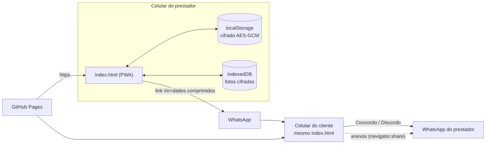
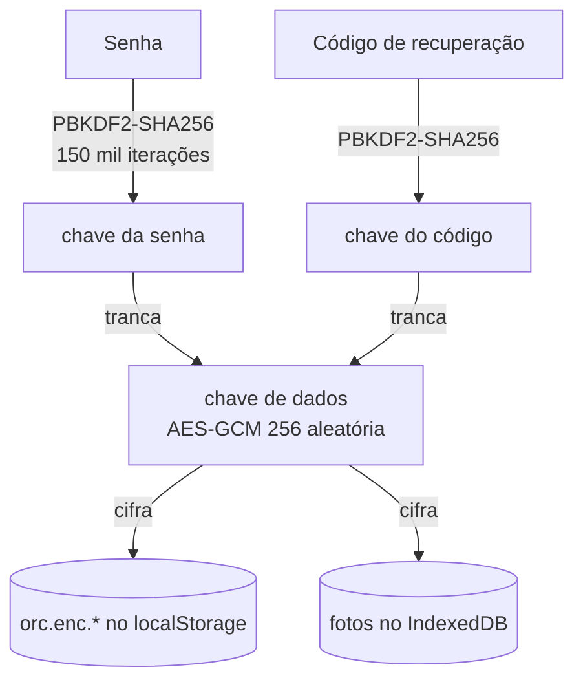

# Arquitetura do app de Orçamentos

Detalhes de implementação (chaves de armazenamento, funções) ficam no [PROJETO.md](../PROJETO.md). Aqui está **como as partes se ligam**.

## 1. Visão geral

Um único `index.html` estático, servido pelo GitHub Pages. Não há backend: o aparelho do prestador guarda tudo, e o orçamento viaja até o cliente dentro do link.

## 2. Duas formas do mesmo app

| | Prestador | Cliente |
|---|---|---|
| Abre | `…/orcamento/` | `…/orcamento/#o=<dados>` |
| Senha | sim (criar, desbloquear, recuperar) | não |
| Vê | editor em 6 etapas, catálogo, clientes, salvos | orçamento pronto, botões Concordo/Discordo, anexos |
| Dados | `localStorage` + IndexedDB, cifrados | só o que está no link; anexos no IndexedDB dele (sem cifra) |

O fragmento `#` nunca é enviado ao servidor: o GitHub Pages entrega o mesmo HTML e o JavaScript lê os dados no próprio navegador.

## 3. Criptografia

- A chave de dados fica trancada duas vezes em `orc.lock`: pela senha e pelo código. Esqueceu a senha → o código destranca e define outra, sem perder dados.
- Em memória (`MEM`), gravação cifrada com atraso de 250 ms e ao ir para segundo plano; pede a senha de novo após 2 min em segundo plano.

## 4. Offline e atualização

`sw.js` usa **rede primeiro**: com internet, sempre a versão nova; sem internet, a cópia em cache. Mudou a lista de arquivos em cache → trocar o nome `CACHE`; o antigo é apagado na ativação.

## 5. Dependências externas

| Recurso | Uso | Proteção |
|---|---|---|
| GitHub Pages | hospedagem https | repositório público: nenhum dado real no código (CI) |
| `wa.me` | abrir o WhatsApp com a mensagem pronta | só o texto da mensagem |
| `cdn.sheetjs.com` — SheetJS 0.20.3 | ler `.xlsx` na importação de clientes | carregado só na hora, com SRI |
| Contact Picker API | importar contatos (Chrome Android) | permissão do próprio aparelho |

## 6. Decisões de arquitetura

| Decisão | Motivo |
|---|---|
| Sem servidor | custo zero, nada a manter, dados do prestador ficam com ele |
| Dados no link (`#o=`) | o cliente vê o orçamento sem conta e sem backend |
| Repositório público | exigência do GitHub Pages gratuito; compensado pelo CI de dados pessoais |
| App genérico, sem marca no código | qualquer prestador usa; nenhum contato real exposto |
| SheetJS do CDN oficial | versões do npm/cdnjs (≤ 0.18.5) têm vulnerabilidades conhecidas |
